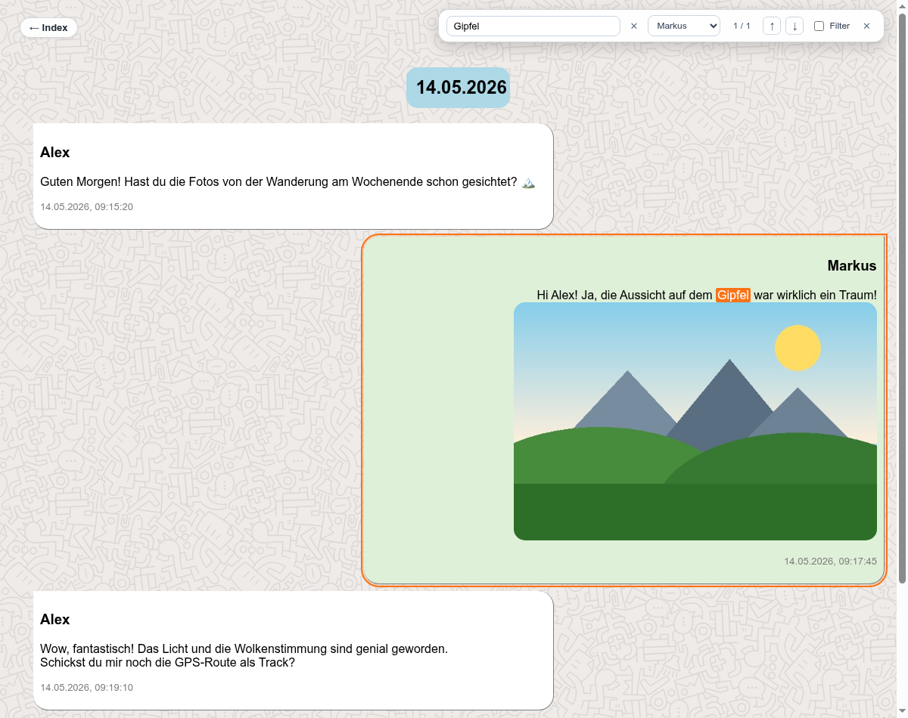

# threema2html

Convert Threema chat exports into beautiful, standalone, long-term preservation friendly HTML archives with embedded client-side search.



---

## Features

- ⚡ **Modern Python 3 CLI**: Fast, clean, and dependency-free (uses only Python standard library).
- 📂 **Chronological Splitting**: Automatically split large chat exports by month or year (`--split month` / `--split year`), generating an `index.html` file connecting all archives.
- 🔍 **Embedded Offline Search**:
  - Full-text search engine embedded directly in generated HTML — works completely offline via `file://` protocol.
  - Multi-word matching (AND logic) and exact phrase matching (`"quotes"`).
  - Filter by chat participant with sender dropdown.
  - Quick keyboard shortcuts (`/`, `Ctrl+K` / `Cmd+K`, `Enter`, `Shift+Enter`, `Esc`).
  - Cross-file search index (`search_index.js`) for split archives.
  - Opt-out via `--no-search` for strictly static, zero-JavaScript HTML.
- 🖼️ **Automatic Media Management**:
  - Automatically identifies and copies referenced media files (`.jpg`, `.jpeg`, `.png`, `.mp4`, `.pdf`, `.vcf`) to `./media/`.
  - Inlines image thumbnails with configurable width (`-w`).
- 🔒 **Privacy & Security Hardened**:
  - Runs 100% locally on your machine — no data is sent to external servers or CDNs.
  - Strict HTML escaping and script-safe JSON serialization.
  - Zero dangerous DOM sinks (`innerHTML`, `outerHTML`, `document.write`).
  - Path traversal protection for media copies.
- 🎨 **Customizable Styling**: Clean chat bubble layout via `./lib/default.css`.

---

## Quick Start

### 1. Export Chat from Threema
1. Open the chat in Threema on your phone.
2. Tap the menu (**⋮**) &rarr; **Export chat**.
3. Choose **Include media files** (if you want photos and documents preserved).
4. *Tip:* For large chats, ensure your phone does not go into standby during export to prevent archive corruption.
5. Transfer the resulting `.zip` file to your computer and unpack it.

### 2. Generate HTML

#### Single File Export
```bash
python3 threema2html.py -n "YourName" messages-chatname.txt > index.html
```

#### Split Large Chats by Month (Recommended)
For long conversations, splitting produces fast, responsive pages and an overview index:
```bash
python3 threema2html.py --split month -n "YourName" messages-chatname.txt
```
This automatically produces:
- `chat_YYYY_MM.html` files
- `index.html` (overview navigation with cross-file search)
- `search_index.js` (lazy-loaded global search index)

#### Split Large Chats by Year
```bash
python3 threema2html.py --split year -n "YourName" messages-chatname.txt
```

---

## Command-Line Options

```
usage: threema2html.py [-h] [-f FROM_DATE] [-t TO_DATE] [-T TITLE] [-n NAME]
                       [-m MEDIA_FOLDER] [-s STYLE_FILE] [-w WIDTH] [-v]
                       [--split {year,month}] [--no-search]
                       inputfile
```

| Option | Description | Default |
| :--- | :--- | :--- |
| `inputfile` | Path to exported Threema text file (`.txt`) | *(Required)* |
| `--split {year,month}` | Split output into separate files by `year` or `month` | *None (single file)* |
| `-n`, `--name` | Name of exporter to substitute for `"Ich"` | `""` |
| `-f`, `--from-date` | Start date filter in `YYYYMMDD` format | `19700101` |
| `-t`, `--to-date` | End date filter in `YYYYMMDD` format | `20701231` |
| `-T`, `--title` | HTML page `<title>` | `"Threema Export"` |
| `-m`, `--media-folder` | Destination directory for copied media files | `./media/` |
| `-s`, `--style-file` | Path or URL to CSS stylesheet | `./lib/default.css` |
| `-w`, `--width` | Thumbnail display width in pixels for inline images | `480` |
| `--no-search` | Disable embedded JavaScript search engine | *Disabled (search included)* |
| `-v`, `--verbose` | Enable verbose diagnostic logging to stderr | *False* |
| `-h`, `--help` | Show help message and exit | |

---

## Embedded Search

Generated HTML pages include a fast, offline-compatible (`file://`) JavaScript search engine by default:

- **Open Search**: Click the floating search button (🔍) in the top-right corner, or press `/` or `Cmd`/`Ctrl`+`K`.
- **Matching Syntax**:
  - Separate words with spaces to require all terms (`AND` match).
  - Use `"exact quotes"` to match multi-word phrases.
  - Select a participant from the **Sender** dropdown to narrow matches.
- **Keyboard Navigation**:
  - `Enter` or `↑`: Step to older matches.
  - `Shift+Enter` or `↓`: Step to newer matches.
  - `Esc`: Clear search and close the search bar.
- **Filter Mode**: Check **Filter** to hide non-matching messages. Uncheck or double-click any message to jump directly to it within the full conversation context.
- **Disable Search**: Pass `--no-search` to produce strictly static HTML without any JavaScript.

---

## Customization

- **Styles**: Tweak `./lib/default.css` to customize bubble colors, fonts, margins, or avatars.
- **Avatars**: The default CSS includes sample CSS selectors (`div.SenderName::before`) to attach contact avatars.
- **Background**: Replace `./lib/wallpaper.png` with any repeating pattern or background image.

---

## Notes & Compatibility

- **Language & Formats**: This script expects German date formats (`DD.MM.YYYY, HH:MM:SS`) and `"Ich"` as the exporter name. For other locales, minor pattern adjustments may be needed.
- **Platform**: Tested on Android-based Threema exports.
- **Backups vs. Chat Exports**: This tool processes Threema's **Chat Export** (`.txt` + media), not complete database backup archives (`.csv`).

---

## Testing

Run the automated test suite using `pytest` or `unittest`:

```bash
pytest tests/test_threema2html.py
# or
python3 -m unittest tests/test_threema2html.py
```

---

## Credits & License

Originally created as an AWK script by Harvey Kramski ([hkramski/threema2html](https://github.com/hkramski/threema2html), moved to [Codeberg](https://codeberg.org/harveyk/threema2html)). Migrated to Python 3 and extended with file splitting, client-side search, and security hardening.
